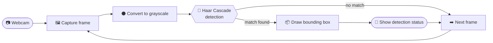

<div align="center">

<!-- 🎯 ───────────────────────────────────────────── 🎯 -->

# 🎯 Real-Time Gun Detection System

### *Computer vision that watches the feed so you don't have to.*

A security application that detects firearms in real time from a webcam,
using **OpenCV** and a **Haar Cascade** classifier — highlighting every
detection with a bounding box.

<br>


<br>

[**Features**](#-features) •
[**Quick start**](#-quick-start) •
[**How it works**](#-how-it-works) •
[**Limitations**](#-limitations--responsible-use) •
[**Contributing**](#-contributing)

</div>

<br>

<!--
  💡 TIP: Add a screenshot or GIF of a detection in action here:
  <p align="center"></p>
-->

---

## 🚀 Overview

This project is a real-time firearm detection system built with **Python** and
**OpenCV**. It uses a pre-trained **Haar Cascade** classifier to spot guns in
live webcam footage.

The application continuously captures video frames, converts them to grayscale
for efficient processing, identifies potential firearms, and draws **bounding
boxes** around anything it detects.

It's a hands-on demonstration of computer vision, object detection and
real-time video processing for **security and surveillance** use cases.

---

## ✨ Features

<table>
  <tr>
    <td width="50%" valign="top">
      <h3>🔫 Real-Time Detection</h3>
      Identifies potential firearms as the video plays.
    </td>
    <td width="50%" valign="top">
      <h3>📷 Live Webcam Monitoring</h3>
      Works directly from your webcam feed.
    </td>
  </tr>
  <tr>
    <td width="50%" valign="top">
      <h3>🧠 Haar Cascade Classifier</h3>
      Lightweight, classic object detection — no GPU required.
    </td>
    <td width="50%" valign="top">
      <h3>📦 Automatic Bounding Boxes</h3>
      Detected objects are outlined right on the frame.
    </td>
  </tr>
  <tr>
    <td width="50%" valign="top">
      <h3>⚡ Fast Frame Processing</h3>
      Grayscale conversion keeps each frame quick to analyze.
    </td>
    <td width="50%" valign="top">
      <h3>🚨 Detection Status Alerts</h3>
      Clear on-screen notification when a detection occurs.
    </td>
  </tr>
</table>

---

## 🛠️ Tech Stack

<div align="center">

| 🐍 Python | 👁️ OpenCV | 🔢 NumPy | 🖼️ Imutils | 🧠 Haar Cascade |
|:-:|:-:|:-:|:-:|:-:|

</div>

<div align="center">
<sub>Computer Vision · Object Detection · Machine Learning</sub>
</div>

---

## 📂 Project Structure

```text
Gun-Detection-System/
│
├── 🐍 gun_detection.py     # Main detection script
├── 🧠 cascade.xml          # Trained Haar Cascade classifier
├── 📋 requirements.txt     # Python dependencies
├── 📖 README.md            # You are here
└── 🖼️ assets/              # Images and media
```

---

## 🚀 Quick Start

### 1️⃣ Clone the repository

```bash
git clone https://github.com/yourusername/Gun-Detection-System.git
cd Gun-Detection-System
```

### 2️⃣ Install dependencies

```bash
pip install -r requirements.txt
```

<details>
<summary><b>📥 Install packages manually</b></summary>

<br>

```bash
pip install opencv-python numpy imutils
```

</details>

### 3️⃣ Run the detector

```bash
python gun_detection.py
```

> [!NOTE]
> Make sure a webcam is connected and that `cascade.xml` sits in the same
> folder as `gun_detection.py`.

---

## 🧠 How It Works



1. **Capture** a frame from the webcam
2. **Convert** it to grayscale for efficient processing
3. **Detect** potential firearms using the Haar Cascade classifier
4. **Highlight** detections with bounding boxes
5. **Notify** with an on-screen detection status
6. **Repeat** for every frame, in real time

---

## ⚠️ Limitations & Responsible Use

> [!WARNING]
> Haar Cascade detectors are fast and lightweight, but they are **sensitive to
> lighting, camera angle and background**, and can produce **false positives
> and missed detections**.

This project is intended for **learning and experimentation**. It should not be
relied on as the only safeguard in a real security setting — always keep a
human in the loop to verify alerts.

---

## 🤝 Contributing

Contributions, suggestions, and improvements are welcome!

1. 🍴 **Fork** this repository
2. 🌿 Create a branch: `git checkout -b feature/your-feature-name`
3. 💾 Commit your changes: `git commit -m "Describe your change"`
4. 🚀 Push: `git push origin feature/your-feature-name`
5. 📬 Open a **pull request**

---

## 📜 License

Licensed under the **MIT License**.

---

<div align="center">

### ⭐ If you found this project helpful, give it a star!

<sub>Built with ☕ and a lot of frames per second 🎥</sub>

</div>
